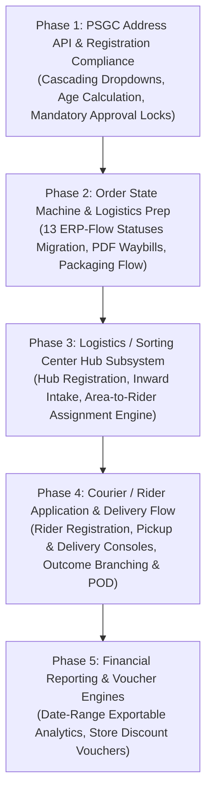

# Loved-IT: Project State, Architecture & Comprehensive Roadmap

**Project Name**: Loved-IT (formerly branded "Velure")  
**Repository**: `basta_velure`  
**Document Version**: 1.1.0  
**Date**: September 23, 2026  
**Authoritative References**:  
- `docs/ERP-Components-updated (2).pdf` (Role & Feature Specification)  
- `docs/ERP-Flow.pdf` (End-to-End Order & Parcel Lifecycle Flow)  

---

## 1. Project Overview

### 1.1 Brand Identity & Mission
**Loved-IT** is an emerging Philippine multi-vendor general e-commerce marketplace designed with mobile-adjacent scope. Conceived as a homegrown alternative to regional giants such as Shopee and Lazada, Loved-IT emphasizes:
- Transparent, merchant-friendly take-rates
- Strict consumer protection through escrow-backed payments and Philippine FDA compliance enforcement
- Direct, accessible merchant-buyer messaging
- A clean, modern UI optimized for both desktop browsers and mobile touchpoints

### 1.2 Technology Stack
- **Backend Framework**: Laravel 11.x (PHP 8.2+) structured around RESTful JSON APIs (`/api/v1/*`)
- **Authentication**: Laravel Sanctum (token-based SPA/mobile auth) + Socialite (Google OAuth)
- **Database**: MySQL 8.0 with InnoDB engine, normalized relational schema, foreign key constraints, and migration tracking
- **Frontend Framework**: React 18 with TypeScript, bundled using Vite
- **Styling System**: Tailwind CSS with role-specific design themes (e.g., modern dark command-center for Admin; warm, light Shopify/Etsy-inspired palette for Sellers; high-conversion red/neutral palette for Buyers)
- **State Management & Data Fetching**: React Context, custom hooks (`useAuth`, `useChat`, `useCart`, `useWishlist`), Axios client with bearer token interceptors
- **Icons & Visuals**: Lucide React icon suite with custom SVG logo system

### 1.3 Core Business Logic & Financial Mechanics
- **Payment Methods**: 
  - **GCash**: Manual proof-of-payment slip upload with reference number capture.
  - **Cash on Delivery (COD)**: Pay upon physical parcel handover.
  - *No automated third-party payment gateways (e.g., PayMongo, Xendit, Stripe) are currently integrated; all transactions utilize manual verification.*
- **Escrow Settlement Architecture**: Simulated manual escrow ledger. Buyer funds (or COD delivery confirmations) are held in platform custody until 7 days post-delivery to allow for buyer inspection and dispute filing, after which seller payout requests become eligible for platform admin approval.
- **Platform Take-Rates (Commission)**:
  - **Standard General Merchandise**: 10.0% platform commission.
  - **Food & Grocery**: 8.0% reduced platform take-rate to support high-turnover local food producers and MSMEs.
  - Commission logic is dynamically evaluated via `PlatformSetting` overrides and category-level database flags (`categories.commission_rate`).
- **Product Taxonomy & Regulatory Safeguards**:
  - 14 distinct parent categories with strict two-level leaf sub-category hierarchy.
  - **Philippine FDA Compliance Gate**: Scoped strictly to the **Food & Grocery** category (and relevant topical items). Sellers listing under FDA-flagged leaf categories are required to provide verifiable License to Operate (LTO) and Certificate of Product Registration (CPR) numbers before listings can be approved.
- **Messaging Architecture**: Polling-based HTTP chat system polling `/api/v1/conversations/*` with conversation context attachments (product cards, order links), built with an architectural fallback to Laravel Reverb WebSockets.

---

## 2. Team & Responsibilities

The Loved-IT engineering and product team consists of four core contributors, with responsibilities organized across system architecture, user experience, quality assurance, and operational domain logic:

| Name | Official Title / Role | Core Responsibilities & Domain Focus |
|---|---|---|
| **Jay Mark (JM) Del Valle** | System Architect & Backend Lead *(Project Coordinator)* | Designs and implements the core Laravel RESTful APIs, MySQL database schemas, Sanctum authentication, simulated escrow financial ledger, real-time messaging services, and system integrations across administrative and merchant modules. |
| **King Ordoña** | Quality Assurance & Integration Specialist | Leads quality assurance, end-to-end user journey auditing across all platform roles, API contract testing, edge-case validation (file uploads, boundary limits, security constraints), and responsive cross-device layout verification. |
| **Liam Rubiales** | Operations & Business Logic Specialist | Formulates merchant and courier onboarding policies, Philippine FDA regulatory compliance rules (LTO/CPR validation), dispute mediation protocols, returns/refunds trees, and end-to-end parcel lifecycle logistics workflows. |
| **Amaru Jay Balmes** | Frontend Architect & UI/UX Specialist | Directs frontend architecture and design systems using React, TypeScript, and Tailwind CSS. Designs intuitive multi-step workflows (listing creation, image sorting, variant matrices), public storefront ergonomics, and role-based portal themes. |

---

## 3. Currently Built (Codebase Inventory)

A granular, verified audit of backend controllers, models, migrations, and frontend React pages in `c:\Projects\basta_velure`:

| Module / Component | Implementation Details | Verified Status |
|---|---|---|
| **Brand Asset System** | `LovedItLogo.tsx` supporting light/dark themes, responsive icon/wordmark variants, brand color tokens (`#ff2d55`, `rose-600`), and typography documented in `COMPANY_BRANDING.md`. | **Done** |
| **About Us Page** | `AboutUsPage.tsx` with mission statement, 6 core values, 5 company milestones, developer team showcase with photos and interactive bio modals. Meets professor deliverable requirements. | **Done** |
| **Public Storefront & Home** | `HomePage.tsx` with dynamic hero banner carousel, promotional cards, top category grid (14 categories), and featured product carousel. Fixed stale images and blank featured product bugs. | **Done** |
| **Catalog & Product Search** | `CatalogPage.tsx` & `PublicProductController.php`: Search query keyword filtering, leaf category tree filtering, minimum/maximum price filters, sort orders (newest, price, popular), and responsive pagination. Fixed "No Products Found" query normalization bug. | **Done** |
| **Product Detail View** | `ProductDetailPage.tsx` & `PublicProductController.php`: Multi-image preview carousel, variant selection (size, color) with dynamic stock/price updates, quantity picker, shop summary card, product reviews listing, and direct "Add to Cart" / "Chat Seller" triggers. | **Done** |
| **Public Shop Profile** | `ShopProfilePage.tsx` & `PublicShopController.php`: Displays merchant banner, store logo, verified badge, store bio, total listings, customer review ratings, and filterable product catalog. | **Done** |
| **Cart & Checkout** | `CartPage.tsx`, `CheckoutPage.tsx`, `BuyerOrderController.php`: Cart item quantity management, multi-seller item grouping, shipping fee calculations, COD and GCash slip upload checkout, and order creation. | **Done** (Voucher engine simulated/UI-only) |
| **Buyer Wishlist & Follows** | `WishlistController.php`, `Wishlist.php`, `WishlistItem.php`, `StoreFollow.php`, and `WishlistContext.tsx`: Add/remove wishlist items, view saved items, follow/unfollow seller shops. | **Done** |
| **Buyer Order Management** | `BuyerOrderController.php`, `SettingsPage.tsx`: Order history list, order detail modal, order status tracking, return/refund request submission with image evidence. | **Done** (Lacks fine-grained courier tracking states) |
| **Buyer Profile & Auth** | `AuthController.php`, `RegisterPage.tsx`, `LoginPage.tsx`, `CompleteProfilePage.tsx`, `GoogleAuthController.php`: Registration, email/password login, Google OAuth, avatar upload, address book management (`AddressController.php`). | **Done** (Instant activation; no mandatory ID approval gate on login) |
| **Chat & Messaging** | `ConversationController.php`, `Conversation.php`, `Message.php`, `useChat.tsx`, `MessengerPanel.tsx`, `BuyerMessagesPage.tsx`, `SellerMessagesPage.tsx`, `AdminMessagesPage.tsx`: Real-time polling chat, conversation thread lists, unread count badges, product and order attachment cards. | **Done** |
| **Seller Dashboard** | `SellerDashboard.tsx`, `SellerLayout.tsx`, `SellerDashboardController.php`: Distinct Shopify/Etsy-inspired light design, revenue cards, pending orders count, low stock warnings, conversion metrics, and recent orders table. Fixed sidebar double-active state bug. | **Done** |
| **Seller Product Management** | `SellerProductsPage.tsx`, `SellerProductController.php`: Product catalog table, live status filter (published, draft, archived, under review), inline quick-edit modal (`SellerEditProductModal.tsx`), stock/price updates, and soft-delete/archive. | **Done** |
| **Add Product Wizard** | `SellerAddProductPage.tsx` with 5-step workflow: `Step0Images.tsx` (drag-and-drop reordering, primary badge), `Step1BasicInfo.tsx` (title, 14-category selector, description), `Step2Variants.tsx` (variant matrices), `Step3Shipping.tsx` (dimensions, weight), and `Step4Fda.tsx` (mandatory LTO & CPR inputs conditionally rendered when Food & Grocery category is chosen). | **Done** |
| **Seller Orders Management** | `SellerOrdersPage.tsx`, `SellerOrderController.php`: Filter orders by status (unpaid, to ship, shipped, delivered, disputed), view customer shipping details, confirm GCash payments, upload tracking notes, and respond to return requests. | **Done** (Missing waybill PDF generation and direct courier dispatch) |
| **Seller Financials & Payouts** | `SellerEarningsPage.tsx`, `SellerEarningsController.php`: Net revenue metrics, platform commission deduction ledger, escrow hold status (7-day rule), available balance calculation, and withdrawal request submission to platform admin. | **Done** |
| **Seller Shop Profile Editor** | `SellerShopProfilePage.tsx`, `SellerShopProfileController.php`: Update shop display name, bio, contact number, pickup address, logo, and store header banner image. | **Done** |
| **Seller Reports & Analytics** | `SellerReportsPage.tsx`, `SellerReportController.php`: Date range sales charts, order volume summaries, and top-selling products. | **Done** |
| **Admin Dashboard Overview** | `AdminDashboardPage.tsx`, `AdminController.php`: High-density dark command center, platform GMV, net commission revenue, registered user counts, pending approval counters, and activity feed. | **Done** |
| **Admin User Management** | `AdminUsersPage.tsx`, `AdminController.php`: List all registered buyers and sellers, inspect profiles, search/filter, and execute account suspend/activate/deactivate actions with reason logging. | **Done** |
| **Admin Buyer Application Queue** | `AdminBuyerApplicationsPage.tsx`, `AdminBuyerApplicationController.php`: Review pending buyer registrations, inspect submitted valid government/school IDs, and approve or reject applications. | **Done** |
| **Admin Seller Application Queue** | `AdminSellerApplicationsPage.tsx`, `AdminSellerApplicationController.php`: Review seller merchant onboarding, inspect DTI/SEC permits, BIR registration, government IDs, and selfie-with-ID, and approve or reject store openings. | **Done** |
| **Admin Product Compliance** | `AdminProductsPage.tsx`, `AdminProductReviewPage.tsx`, `AdminProductController.php`: Review flagged or submitted listings, verify category classification, inspect FDA documents for Food & Grocery items, approve/reject products, or force archive violating listings. | **Done** |
| **Admin Category Taxonomy** | `AdminCategoriesPage.tsx`, `AdminCategoryController.php`: Manage 14 parent categories and leaf sub-categories, toggle active status, configure FDA verification flags (`requires_fda`), and set custom take-rate overrides (`commission_rate`). | **Done** |
| **Admin Orders & Disputes** | `AdminOrdersPage.tsx`, `AdminOrderController.php`, `AdminDisputesPage.tsx`, `AdminDisputeController.php`: View all platform orders, inspect payment slips, mediate customer return/refund disputes, upload resolution findings, and execute binding escrow payouts or refunds. | **Done** |
| **Admin Finance & Payouts** | `AdminPaymentsPage.tsx`, `AdminPaymentController.php`, `AdminPayoutController.php`: Verify manual GCash payment slips, mark orders paid, review seller payout requests, log bank/GCash disbursement references, and deduct platform commission. | **Done** |
| **Admin Reports & Audit** | `AdminReportsPage.tsx`, `AdminReportController.php`, `AdminActivityLogPage.tsx`: Platform sales summaries, commission revenue reports, and immutable audit logs of administrative actions. | **Done** |
| **Admin Platform Settings** | `AdminPlatformSettingsPage.tsx`, `AdminPlatformSettingController.php`: Edit platform standard commission rate (default 10%), return window duration, maintenance mode, and customer support contacts. | **Done** |
| **Courier / Rider Module** | Rider registration, vehicle documentation, parcel pickup dashboard, delivery tracking, courier earnings ledger. | **0% Built (Unimplemented)** — Route `/admin/rider-applications` maps to `AdminPlaceholderPage.tsx`. No backend controllers or models exist. |
| **Logistics / Sorting Center Module** | Sorting hub onboarding, parcel intake/inward scanning, area-based delivery routing, rider dispatch, delivery monitoring. | **0% Built (Unimplemented)** — No backend controllers, database tables, or frontend pages exist. |

---

## 4. Target Full Scope (Role & Feature Specification)

Derived directly from the authoritative ERP specification document (`docs/ERP-Components-updated (2).pdf`), the complete scope encompasses five distinct operational roles:

### 4.1 Role 1: Buyer
1. **Registration Flow**:
   - Compulsory personal information: Last name\*, First name\*, Middle initial, Sex\*, E-mail\*, Contact No.\*, Birthday\*, Age (autogenerated from birthday)\*.
   - Philippine Address Selection via API: Hierarchical dropdowns for Province, Municipality/City, Barangay; manual text entry for Street, Building, House Number, etc.
   - Mandatory Identification: Upload valid government/student ID image.
   - Approval Gate: Explicit submission message stating: *"After submitting your registration, please wait for the administrator's approval, which will be sent to your email."*
2. **Authentication**: Email and password login (with approval verification).
3. **Main Menu & Marketplace Experience**:
   - **Categories**: Browse curated marketplace taxonomy across all 14 parent categories.
   - **Product Search**: Search bar with keyword match, view product detail pages, select item quantity, configure variations (color, size, material), and add to shopping cart.
   - **Cart & Checkout**: Select cart items, finalize order details, apply store/platform vouchers and discounts, choose payment method (COD or GCash), and place order.
   - **Order Lifecycle & Tracking**: Real-time status stages: *To Ship*, *In Transit*, *Out for Delivery*, *Delivered / Rate & Feedback*, *Cancelled*, *Disputed / Return Requested*.
   - **Chat / Messaging**: In-platform direct messaging with merchants for pre-purchase inquiries and order support.
   - **Account Management**: Profile info, delivery addresses, security settings.
   - **Session Logout**: Secure token invalidation.

---

### 4.2 Role 2: Seller
1. **Registration Flow**:
   - Owner information: Last name\*, First name\*, Middle initial, Sex\*, E-mail\*, Contact No.\*, Birthday\*, Age (autogenerated)\*.
   - Business address via API: Dropdowns for Province, Municipality/City, Barangay + manual street address.
   - Commercial details: Registered Business Name, Line of Business (Primary Category).
   - Compliance documentation: Upload valid government ID + upload DTI/SEC Business Permit (and FDA LTO if applicable).
   - Approval Gate: Form submission notice: *"After submitting your registration, please wait for the administrator's approval, which will be sent to your email."*
2. **Authentication**: Dedicated merchant login.
3. **Dashboard Overview**: Real-time business metrics, revenue graphs, order volume counters, and inventory health alerts.
4. **Order Management**:
   - **Inventory Management**: Add, update, archive products; configure regular prices, promotional discounts, and vouchers; monitor live stock thresholds.
   - **Order Notifications**: Review new incoming orders and view granular item details.
   - **Order Preparation**: Pack items, generate and print formal PDF waybills/shipping labels with barcodes.
   - **Courier Handover**: Schedule courier/sorting center pickup, track shipment transit status.
   - **Delivery Confirmation**: Receive automated delivery notifications once the customer receives the parcel.
   - **Customer Feedback**: Review buyer ratings, respond to product reviews, and participate in dispute resolutions.
5. **Reports Generation**: Generate financial and profit reports with custom start/end date range pickers; sales velocity and performance tracking.
6. **Chat / Messaging**: Dedicated merchant inbox to communicate with buyers, administrators, and couriers.
7. **Account Management & Logout**: Shop branding, bank/GCash payout accounts, security settings, and session termination.

---

### 4.3 Role 3: Courier (Rider)
1. **Registration Flow**:
   - Personal credentials: Last name\*, First name\*, Middle initial, Sex\*, E-mail\*, Contact No.\*, Birthday\*, Age (autogenerated)\*.
   - Base address via API: Dropdown hierarchy (Province, Municipality, Barangay) + manual street address.
   - Fleet details: Vehicle selection (Motorcycle, Sedan, MPV/Van, Light Truck) + Vehicle License Plate Number.
   - Regulatory documents: Upload official vehicle registration (OR/CR) + upload valid Driver's License.
   - Approval Gate: Notice indicating: *"After submitting your registration, please wait for the Logistic/Sorting Center's approval, which will be sent to your email."* *(Note: Couriers are vetted by the Logistics/Sorting Center, not directly by Admin).*
2. **Authentication**: Secure mobile/web login for field couriers.
3. **Pickup Dashboard**: "Items for Pickup" console showing seller locations, scheduled pickup time slots, parcel quantities, and real-time pickup request alerts.
4. **Delivery Dashboard**: "Items for Delivery" console showing assigned parcels, recipient addresses, contact numbers, and turn-by-turn dispatch queues.
5. **Operational Execution**:
   - **Pickup Order**: Scan/verify parcels at seller location, confirm pickup handover, and update parcel state to *In Transit*.
   - **Deliver Order**: Navigate to buyer address, verify payment (collect COD if applicable), capture proof-of-delivery (photo/signature), and mark parcel *Delivered*.
6. **Profit & Earnings Dashboard**: Daily, weekly, and monthly delivery fee earnings, completed runs, distance compensation, and remittance balances.
7. **Delivery History**: Complete log of all past deliveries, cancellations, and return-to-sender parcels.
8. **Chat / Messaging**: Communication channel with buyers, sellers, and logistics dispatchers.
9. **Account Management & Logout**: Vehicle detail updates, contact settings, and session logout.

---

### 4.4 Role 4: Platform Administrator
1. **Authentication**: High-security administrative login.
2. **Platform Dashboard**: High-level operational metrics (GMV, platform net revenue, active user counts, logistics throughput, system health alerts).
3. **Account Registrations Management**:
   - Comprehensive approval queues for **Buyer**, **Seller**, and **Logistics/Sorting Center** applications.
   - Verification of submitted IDs, business permits, and operational documents.
   - Formal Approve / Disapprove actions with automated decision notification emails dispatched to applicants.
4. **User Account Governance**: Universal user registry; view profiles across all roles; execute *Activate*, *Suspend*, or *Deactivate* sanctions with detailed audit trails.
5. **Seller Compliance Monitoring**:
   - Verify that listed products strictly conform to the merchant's registered category.
   - Inspect and detect prohibited, counterfeit, or unapproved items.
   - Enforce Philippine FDA compliance (LTO and CPR) on Food & Grocery listings.
   - Issue formal violation warnings or execute seller account suspension.
6. **Complaints & Dispute Management**: Review return/refund claims, inspect photographic evidence, mediate discussions between Buyer, Seller, and Courier, and issue final binding escrow resolutions.
7. **Commission Management (10% Base)**: Platform take-rate configuration, automatic calculation of 10% standard fee (and 8% Food & Grocery override), escrow fee deductions, and remittance tracking.
8. **Platform Financial & Analytical Reports**: Generate comprehensive platform-wide Sales Summary Reports and Commission Earned Reports across customizable date ranges.
9. **Platform Settings & Policies**: Publish platform-wide announcements, edit Terms of Service, Privacy Policies, Return & Refund policies, and operational parameters.
10. **Chat / Messaging, Account Management & Logout**: Administrative support messaging, credential management, and logout.

---

### 4.5 Role 5: Logistics / Sorting Center
1. **Registration Flow**:
   - Entity representative info: Last name\*, First name\*, Middle initial, Sex\*, E-mail\*, Contact No.\*, Birthday\*, Age (autogenerated)\*.
   - Hub location via API: Dropdown hierarchy (Province, Municipality, Barangay) + exact warehouse address.
   - Entity details: Registered Logistics Business Name.
   - Corporate documents: Upload valid representative ID + DTI/SEC Business Permit.
   - Approval Gate: Notice stating: *"After submitting your registration, please wait for the administrator's approval, which will be sent to your email."*
2. **Authentication**: Warehouse management system login.
3. **Logistics Command Dashboard**: Inward volume, parcels in sorting, pending courier pickups, assigned out-for-delivery parcels, and delivery success rates.
4. **Rider Management**:
   - Dedicated vetting queue for Courier applicants.
   - Review driver's license, OR/CR, vehicle plates.
   - Approve, Disapprove, Activate, or Deactivate riders assigned to the sorting hub.
5. **Parcel Intake & Seller Pickup Verification**: Confirm and approve seller parcel pickup requests; schedule riders for merchant collection.
6. **Management of Incoming Parcels**: Receive parcels arriving at the hub from merchant collections and verify barcode/tracking manifest.
7. **Parcel Sorting**: Sort parcels into destination bins based on delivery zones, postal codes, and barangays.
8. **Delivery Assignment**: Assign sorted parcel batches to active couriers based on coverage zone, vehicle capacity, and optimal routing.
9. **Delivery Monitoring**: Live tracking of parcels out for delivery, failed attempt tracking, and return-to-sender (RTS) triage.
10. **Logistics Reporting**: Hub throughput reports, on-time delivery rate reports, rider efficiency reports, and damaged parcel logs.
11. **Chat / Messaging, Account Management & Logout**: Dispatcher chat with couriers, sellers, and administrators; hub settings and logout.

---

### 4.6 Order & Parcel Lifecycle (End-to-End ERP Flow)

As formalized in `docs/ERP-Flow.pdf`, the core operational pipeline coordinates four interacting roles (Buyer, Seller, Rider/Courier, and Sorting Center/Logistics) through an explicit, sequential handoff model:

```
[Buyer Places Order]
         │
         ▼
[Seller Prepares & Packs] ────> [Prints Shipping Label] ────> [Marks Ready for Pickup]
                                                                     │
         ┌───────────────────────────────────────────────────────────┘
         ▼
[Rider Accepts Pickup] ───────> [Collects from Seller] ────> [Delivers to Sorting Center]
                                                                     │
         ┌───────────────────────────────────────────────────────────┘
         ▼
[Sorting Center Scans] ───────> [Sorts by Destination Area] ─> [Assigns to Area Rider]
                                                                     │
         ┌───────────────────────────────────────────────────────────┘
         ▼
[Rider Out for Delivery] ─────> [Travels to Customer]
                                       │
                  ┌────────────────────┴────────────────────┐
                  ▼                                         ▼
            [DELIVERED]                             [DELIVERY FAILED]
                  │                                         │
                  ▼                                         ▼
      [Buyer Confirms Receipt]                     [Record Failure Reason]
                  │                                         │
                  ▼                                         ▼
             [COMPLETED]                        [Reschedule OR Return to Seller]
```

#### 4.6.1 Step-by-Step Flow per Role

1. **Buyer Flow**:
   - Buyer Registration → Wait for Admin Approval → Login.
   - Browse Products → View Product Details → Select Variations → Add to Cart.
   - Go to Checkout → Enter / Confirm Delivery Address → Select Payment Method (COD or GCash slip).
   - Place Order → Wait for Seller to Prepare Order.
   - Once dispatched through logistics chain: Receive Product → Confirm Order Received → Transaction Completed.

2. **Seller Flow (Receive, Pack & Prepare Order for Pickup)**:
   - Buyer Places Order → Seller Receives Order Notice → View Order Details.
   - Check Product / Stock Availability → Accept / Confirm Order (`CONFIRMED`).
   - Prepare Order (`PREPARING`) → Pack Product.
   - Print & Attach Formal Shipping Label / Waybill.
   - Mark as Ready for Pickup (`READY_FOR_PICKUP`).
   - Wait for Rider Assignment → Rider Arrives at Merchant Location.
   - Hand Over Parcel → Confirm Rider Pickup (`PICKED_UP`).

3. **Rider / Courier Flow (Pickup Leg)**:
   - Rider Logs In → View Pickup Assignments Console.
   - Accept Pickup Assignment → Travel to Seller Location.
   - Pick Up Parcel from Seller → Scan / Confirm Parcel Handoff.
   - Deliver Parcel to Logistics / Sorting Center (`AT_SORTING_CENTER`).
   - *Key Rule*: The pickup rider is responsible specifically for collecting the parcel from the merchant and bringing it safely into the sorting hub.

4. **Sorting Center / Logistics Flow (Intake, Sorting & Routing)**:
   - Receive Parcel at Hub → Scan Parcel Barcode (`AT_SORTING_CENTER`).
   - Read Delivery Address → Determine Designated Delivery Area.
   - Sort Parcel According to Destination Area (`SORTED`).
   - Identify Rider Assigned to that Delivery Area.
   - Assign Parcel to Designated Rider (`ASSIGNED_TO_RIDER`).
   - *Two Core Responsibilities of the Sorting Center*:
     1. Sort the parcel according to destination geographic area.
     2. Assign the parcel to the appropriate rider based on that rider's registered coverage zone.
   - *Operating Routing Model (from Specification)*:
     - **Parcel #1001**: Santa Cruz, Laguna → **Area A** → Assigned to **Rider 01**
     - **Parcel #1002**: Pagsanjan, Laguna → **Area B** → Assigned to **Rider 02**
     - **Parcel #1003**: Los Baños, Laguna → **Area C** → Assigned to **Rider 03**

5. **Rider / Courier Flow (Delivery Leg & Outcome Branching)**:
   - Rider Receives Delivery Assignment → View Delivery Address and Recipient Notes.
   - Pick Up Sorted Parcel from Sorting Center Hub.
   - Mark Parcel as Out for Delivery (`OUT_FOR_DELIVERY`).
   - Travel to Customer Destination → Deliver Parcel (collect COD if applicable).
   - Customer Receives Parcel.
   - **Delivery Outcome Branching**:
     - **Branch YES (Successful Delivery)**:
       - Update Status to `DELIVERED`.
       - Buyer Inspects Package & Confirms Receipt on Platform.
       - Status transitions to `COMPLETED` (escrow 7-day countdown commences).
     - **Branch NO (Unsuccessful Delivery)**:
       - Update Status to `DELIVERY_FAILED`.
       - Explicit failure reason recorded (e.g., Customer Unreachable, Incorrect Address, Refused COD Payment, Force Majeure).
       - Route to operational resolution: **Reschedule Delivery** (retry next business day) OR **Return Parcel to Seller** (`RETURNED`).

---

#### 4.6.2 Formal Order Status State Machine

The Loved-IT platform enforces 13 sequential order lifecycle states:

| # | Status Constant | One-Line Meaning & Transition Trigger | Actor / Authority |
|---|---|---|---|
| 1 | `PLACED` | Buyer successfully checked out and placed the order. | Buyer / System |
| 2 | `CONFIRMED` | Seller verified inventory availability and accepted the order. | Seller |
| 3 | `PREPARING` | Seller is assembling, packaging, and boxing the purchased items. | Seller |
| 4 | `READY_FOR_PICKUP` | Parcel is packed with shipping label attached, awaiting pickup dispatch. | Seller |
| 5 | `PICKED_UP` | Assigned pickup rider arrived, verified parcel, and collected from seller. | Pickup Rider |
| 6 | `AT_SORTING_CENTER` | Parcel arrived at the hub warehouse and was scanned into intake inventory. | Sorting Center Staff |
| 7 | `SORTED` | Parcel has been sorted into its destination zone bin (e.g., Area A/B/C). | Sorting Center Staff |
| 8 | `ASSIGNED_TO_RIDER` | Parcel has been assigned to the designated last-mile delivery rider for that area. | Sorting Center Hub |
| 9 | `OUT_FOR_DELIVERY` | Delivery rider has loaded the parcel and is actively traveling to the buyer. | Delivery Rider |
| 10 | `DELIVERED` | Parcel successfully handed over to the buyer (and COD collected). | Delivery Rider |
| 11 | `COMPLETED` | Buyer confirmed receipt on platform, or automated completion timer expired. | Buyer / System |
| 12 | `DELIVERY_FAILED` | Delivery attempt failed (customer absent, invalid address, COD refusal). | Delivery Rider |
| 13 | `RETURNED` | Delivery attempts exhausted or dispute resolved; parcel returned to seller. | Sorting Center / Rider |

```
Summary Chain:
Buyer orders → Seller prepares → Rider picks up → Sorting Center sorts → Sorting Center assigns Rider → Rider delivers → Buyer confirms → Order completed.
```

---

## 5. Gap Analysis & Future Roadmap

Comparing the **Currently Built** codebase (Section 3) against the **Target ERP Specification** (Section 4) and **End-to-End ERP Flow** (Section 4.6) reveals clear functional accomplishments and specific gaps to be addressed:

```
[==================== CURRENT STATUS OVERVIEW ====================]
  Admin Platform:          85% Built (Core queues & moderation live)
  Seller Suite:            80% Built (Catalog, orders, finances live)
  Buyer Experience:        75% Built (Storefront, cart, checkout live)
  Courier (Rider):          0% Built (Unimplemented)
  Logistics/Sorting Center: 0% Built (Unimplemented)
```

### 5.0 Order Status State Machine Reconciliation & Migration

A rigorous audit of the current database schema (`2026_08_13_100000_create_orders_payments_disputes_reviews_tables.php`) reveals the current `orders.status` enum values:
```sql
ENUM('pending', 'confirmed', 'packed', 'shipped', 'out_for_delivery', 'delivered', 'cancelled', 'returned')
```

#### Mapping Existing Codebase Statuses to ERP-Flow Target State Machine:
| Codebase Status (Old) | Target ERP-Flow Status (New) | Reconciliation Notes & Action Required |
|---|---|---|
| `pending` | `PLACED` | Direct 1:1 mapping. Represents buyer order placement awaiting seller acceptance. |
| `confirmed` | `CONFIRMED` | Direct 1:1 mapping. Seller accepts order and confirms stock availability. |
| `packed` | `PREPARING` / `READY_FOR_PICKUP` | **Split Required**: The codebase conflates packaging and pickup readiness into a single `packed` state. Must split into `PREPARING` (packing underway) and `READY_FOR_PICKUP` (waybill attached, waiting for rider). |
| `shipped` | `PICKED_UP` / `AT_SORTING_CENTER` / `SORTED` / `ASSIGNED_TO_RIDER` | **Split Required**: The current codebase treats shipping as a monolithic black box. In the ERP flow, `shipped` spans 4 distinct multi-actor logistics states. |
| `out_for_delivery` | `OUT_FOR_DELIVERY` | Direct 1:1 mapping. Rider is en route to customer destination. |
| `delivered` | `DELIVERED` | Direct 1:1 mapping. Parcel handed over to recipient. |
| *(None)* | `COMPLETED` | **Completely Missing**: Current system stops at `delivered`. The ERP specification mandates a distinct `COMPLETED` state triggered when the buyer explicitly confirms receipt. |
| *(None)* | `DELIVERY_FAILED` | **Completely Missing**: No existing table or column records failed delivery attempts, failure reasons, or rescheduling flags. |
| `returned` | `RETURNED` | Direct 1:1 mapping. Parcel returned to merchant location. |
| `cancelled` | `CANCELLED` | Preserved for pre-fulfillment buyer/seller cancellations. |

> [!IMPORTANT]
> **Roadmap Sequencing Priority**: Migrating `orders.status` to the 13 ERP-Flow statuses is a **hard prerequisite** for both the Courier and Sorting Center modules. Every controller, dispatch queue, and mobile view in those subsystems depends upon these granular states. Consequently, this migration is **sequenced into Phase 1 / Phase 2**, rather than deferred to Phase 3 or 4.

---

### 5.1 Buyer Role Gap Analysis
| Target Specification Feature | Status in Codebase | Required Work / Implementation Steps |
|---|---|---|
| **Personal Info & Auto-Age** | Partial | Add `birthdate` and autogenerated `age` logic to `RegisterPage.tsx` and `CompleteProfilePage.tsx`. Database has `birthdate` column on `users` table. |
| **Philippine Address API** | Partial | Current system uses standard text input for street and manual inputs. Must integrate the Philippine Standard Geographic Code (PSGC) API to provide dynamic cascading dropdowns (`Province` → `City/Municipality` → `Barangay`). |
| **Mandatory ID Upload & Approval Wait** | Partial | Database schema supports `government_id_url` and `government_id_type`. Admin approval screen exists (`AdminBuyerApplicationsPage.tsx`). However, current buyer registration enables instant login without blocking unapproved buyers with the required pending email notification screen. |
| **Catalog & Search with Variations** | **Done** | Complete with filters, search, and dynamic variant matrix on `ProductDetailPage.tsx`. |
| **Cart with Vouchers & Discounts** | Partial | Cart item management and COD/GCash checkout are fully functional. Voucher engine is currently a frontend placeholder; requires a `vouchers` table, coupon code redemption endpoint, and discount validation logic. |
| **Granular Order Status Tracking** | Partial | Current view shows 4 basic states. Must update buyer order tracker to display the full 13-stage lifecycle (`PLACED` → `CONFIRMED` → `PREPARING` → `READY_FOR_PICKUP` → `PICKED_UP` → `AT_SORTING_CENTER` → `SORTED` → `ASSIGNED_TO_RIDER` → `OUT_FOR_DELIVERY` → `DELIVERED` → `COMPLETED`). |
| **Confirm Order Received Action** | **Missing** | Add explicit "Confirm Receipt" button in buyer order details modal that transitions `DELIVERED` → `COMPLETED` and unlocks the product review modal. |
| **Product Rating & Feedback** | **Done** | `reviews` table, `Review.php` model, and `AdminReviewController.php` exist. Must ensure review prompt is prominently shown once an order reaches `delivered`/`completed` status. |
| **Chat / Messaging** | **Done** | Complete via `useChat.tsx` and `ConversationController.php` with item attachment capabilities. |

---

### 5.2 Seller Role Gap Analysis
| Target Specification Feature | Status in Codebase | Required Work / Implementation Steps |
|---|---|---|
| **Registration w/ Permits & Auto-Age** | **Done** | Form captures owner info, business name, line of business, permits, and ID. Admin approval queue is fully implemented in `AdminSellerApplicationsPage.tsx`. |
| **Dashboard Overview** | **Done** | Revenue metrics, orders attention count, and inventory alerts live in `SellerDashboard.tsx`. |
| **Inventory & Add Product** | **Done** | 5-step wizard with drag-to-reorder images, variant matrices, and conditional FDA validation for Food & Grocery. |
| **Vouchers & Promotional Pricing** | Partial | Product discounts exist via `compare_at_price`. Seller-generated coupon/voucher creation interface is missing. |
| **Order Acceptance & Preparation Workflow** | Partial | Sellers can view orders. Must introduce distinct status actions: "Accept Order" (`CONFIRMED`), "Start Packing" (`PREPARING`), and "Mark Ready for Pickup" (`READY_FOR_PICKUP`). |
| **Waybill / Shipping Label Printing** | **Missing** | Sellers currently view order details in a table, but cannot generate or print standardized PDF shipping waybills with parcel barcodes, destination area codes, and recipient routing data. |
| **Courier Handover & Pickup Verification** | **Missing** | Add "Confirm Rider Pickup" action in `SellerOrdersPage.tsx` where the merchant scans/verifies the arriving rider and transitions order to `PICKED_UP`. |
| **Financial & Profit Reports with Date Picker** | Partial | Basic charts exist in `SellerReportsPage.tsx`. Must add date range picker (`from_date` to `to_date`) to compute exact net profit and sales velocity. |
| **Chat & Feedback Management** | **Done** | Messaging and review visibility live in `SellerMessagesPage.tsx` and shop profiles. |

---

### 5.3 Admin Role Gap Analysis
| Target Specification Feature | Status in Codebase | Required Work / Implementation Steps |
|---|---|---|
| **Dashboard Platform Overview** | **Done** | Real-time GMV, active listings, revenue, and pending queue summaries live on `AdminDashboardPage.tsx`. |
| **Account Registration Approval Queues** | Partial | **Buyer** and **Seller** approval queues are fully functional with ID inspection. **Logistics/Sorting Center** application queue does not exist yet. Automated email dispatch upon approval/rejection needs Laravel Mail integration. |
| **User Account Governance** | **Done** | Search, filter, activate, suspend, and deactivate users live in `AdminUsersPage.tsx`. |
| **Seller Compliance & FDA Monitoring** | **Done** | Product moderation queue checks categories and verifies FDA CPR/LTO documents for Food & Grocery listings. |
| **Dispute & Complaint Mediation** | **Done** | Formal dispute resolution console with evidence viewer and binding payout/refund actions in `AdminDisputesPage.tsx`. |
| **10% Commission Calculation** | **Done** | Automated 10% standard (and 8% category override) deductions calculated in `SellerEarningsController.php` and `AdminPaymentController.php`. |
| **Platform Financial Reports** | Partial | High-level summaries exist in `AdminReportsPage.tsx`. Must add downloadable export (CSV/PDF) for Sales Summary and Commission Breakdown reports. |
| **Platform Announcements & Policies** | Partial | Policy editor exists in `AdminPlatformSettingsPage.tsx`. Need a public-facing platform announcement banner system for site visitors. |

---

### 5.4 Courier (Rider) Role Gap Analysis *(NOT YET BUILT — 0%)*
Cross-referencing `ERP-Components-updated (2).pdf` and `ERP-Flow.pdf` establishes the complete technical requirements for the rider subsystem:

| Target Specification Feature | Implementation Roadmap & Architecture Needed |
|---|---|
| **Database Schema** | Create `courier_profiles` table: `user_id`, `vehicle_type` (motorcycle, car, van, truck), `plate_number`, `or_cr_url`, `driver_license_url`, `sorting_center_id`, `approval_status`, `is_active`, `current_lat`, `current_lng`. |
| **Courier Registration Flow** | Build `CourierRegisterPage.tsx` capturing personal data, vehicle selection, plate number, OR/CR upload, driver's license upload, and sorting center selection. |
| **Rider Onboarding Approval** | Route courier applications to the designated **Logistics/Sorting Center** for review and approval (not direct Admin approval). |
| **Rider Pickup Workflow (ERP-Flow)** | Build dedicated console (`/courier/pickups`) supporting the exact 5-step pickup lifecycle: **View Pickup Assignments** → **Accept Pickup** → **Go to Seller** → **Pick Up Parcel** → **Scan/Confirm Parcel** → **Deliver to Sorting Center** (`AT_SORTING_CENTER`). |
| **Rider Delivery Workflow (ERP-Flow)** | Build last-mile console (`/courier/deliveries`) supporting the sequential delivery steps: **Receive Assignment** → **View Delivery Address** → **Pick Up from Hub** → **Mark Out for Delivery** (`OUT_FOR_DELIVERY`) → **Travel to Customer** → **Deliver Parcel**. |
| **Delivery Outcome Branching** | In-app delivery completion modal supporting two operational branches:<br/>• **Success Branch**: Mark `DELIVERED`, collect COD amount if applicable, capture recipient photo/signature.<br/>• **Failure Branch**: Mark `DELIVERY_FAILED`, select required reason code (Customer Unreachable, Wrong Address, Customer Refused, Damaged Parcel, Force Majeure), and flag parcel for **Reschedule** or **Return to Seller** (`RETURNED`). |
| **Courier Profit Dashboard** | Ledger tracking per-delivery payout fees, completed trips, daily totals, and collected COD remittance balances. |
| **Delivery History** | Searchable audit archive of all completed, returned, or failed delivery attempts. |

---

### 5.5 Logistics / Sorting Center Role Gap Analysis *(NOT YET BUILT — 0%)*
Cross-referencing `ERP-Components-updated (2).pdf` and `ERP-Flow.pdf` establishes the warehouse hub architecture:

| Target Specification Feature | Implementation Roadmap & Architecture Needed |
|---|---|
| **Database Schema** | • Create `sorting_centers` table: `user_id`, `hub_name`, `hub_code`, `address_id`, `dti_permit_url`, `coverage_areas_json`, `is_active`.<br/>• Create `parcels` table: `tracking_number`, `order_id`, `sorting_center_id`, `pickup_rider_id`, `delivery_rider_id`, `area_code`, `status`, `scanned_in_at`, `sorted_at`, `dispatched_at`.<br/>• Create **`rider_area_assignments` table**: Maps riders to designated geographic coverage areas (e.g., `rider_id`, `sorting_center_id`, `area_code`, `municipality`, `barangays_json`, `is_active`). |
| **Logistics Center Registration** | Build `SortingCenterRegisterPage.tsx` capturing hub credentials, warehouse manager info, DTI permit, and coverage barangays; submitted to Admin approval queue. |
| **Admin Hub Approval Queue** | Extend Admin console with `AdminSortingCenterApplicationsPage.tsx` to vet and authorize logistics hubs. |
| **Hub Command Dashboard** | Warehouse console (`/hub/dashboard`) showing inbound parcels from sellers, parcels in sorting bins, and couriers currently active on routes. |
| **Rider Vetting & Area Mapping** | Hub interface (`/hub/riders`) allowing warehouse managers to approve/disapprove courier applicants AND assign riders to specific coverage delivery zones (Area A, Area B, Area C). |
| **Parcel Intake & Inward Scanning** | Module to verify merchant pickup dispatches, scan barcode upon arrival at hub, and update order status to `AT_SORTING_CENTER`. |
| **Core Duty 1: Area Destination Sorting** | Warehouse sorting view to read delivery addresses (e.g., Santa Cruz, Pagsanjan, Los Baños) and group parcels into destination area bins (`SORTED`). |
| **Core Duty 2: Area-to-Rider Assignment** | Dispatch interface to look up the rider mapped to that area and bulk-assign sorted parcels (`ASSIGNED_TO_RIDER`). |
| **Delivery Monitoring & Triage** | Live tracking of parcels out for delivery, failure reason log review, rescheduling authorization, and return-to-seller processing (`RETURNED`). |
| **Logistics Reports** | Hub throughput metrics, delivery success/failure rates, average turnaround time, and rider fulfillment performance. |

---

## 6. Known Technical Decisions & Constraints

1. **Payment Processing**:
   - Strictly limited to **GCash manual receipt upload** and **Cash on Delivery (COD)**.
   - Third-party payment gateway SDKs (PayMongo, Stripe, Xendit, Maya) are intentionally excluded from the project scope to adhere to curriculum constraints and avoid third-party commercial transaction fees.
2. **Simulated Escrow Ledger**:
   - All funds from GCash payments and confirmed COD remittances enter a platform-managed escrow hold.
   - Payout eligibility is governed by a 7-day post-delivery holding window. Once this window elapses without an active dispute, funds shift to the merchant's withdrawable balance, which is settled via manual bank/GCash transfer by the administrator.
3. **FDA Compliance Scope**:
   - Philippine Food and Drug Administration (FDA) verification (LTO and CPR) is strictly enforced only on listings classified under the **Food & Grocery** category. Non-ingestible categories (e.g., Electronics, Fashion, Home & Living) bypass FDA gates during product listing.
4. **Philippine Geographic Data**:
   - Address inputs will transition from free-form text to standardized PSGC cascading dropdowns (`Province` → `City/Municipality` → `Barangay`) to ensure accurate delivery routing for sorting centers and couriers.
5. **Real-Time Communication Architecture**:
   - The messaging platform uses an HTTP polling mechanism (`useChat.tsx`) configured for 3-second intervals when active. While backend WebSocket events via Laravel Reverb are pre-configured in `0001_01_01_000001_upgrade_conversations_and_messages_table.php`, HTTP polling guarantees robust message delivery across varied hosting environments without requiring a persistent daemon process.
6. **Mobile Application Scope & Architecture**:
   - **In Scope**: A fully responsive, mobile-first web architecture (viewport breakpoints down to 360px), touch-optimized controls for rider pickup/delivery consoles, and Progressive Web App (PWA) manifest capabilities for field courier use.
   - **Out of Scope**: Native compiled mobile binaries (iOS `.ipa` / Swift or Android `.apk` / Kotlin / Flutter) are explicitly out of scope for the MVP phase. All roles (Buyers, Merchants, Couriers, Sorting Center operators, and Administrators) operate via mobile and desktop web browsers.

---

## 7. Recommended Implementation Sequence

To achieve full ERP specification compliance efficiently, the following phased execution order is recommended:



### Phase 1: PSGC Address Integration & Registration Flow Uniformity
- Integrate PSGC API cascading dropdowns across Buyer, Seller, Courier, and Sorting Center registration forms.
- Add birthdate picker with client-side autogenerated age computation.
- Enforce the post-registration approval gate across all roles with pending approval notification screens.

### Phase 2: Order State Machine Migration & Seller Logistics Preparation
- **Migrate Database Schema to 13 ERP-Flow Statuses**: Execute database migration updating `orders.status` enum to `['PLACED', 'CONFIRMED', 'PREPARING', 'READY_FOR_PICKUP', 'PICKED_UP', 'AT_SORTING_CENTER', 'SORTED', 'ASSIGNED_TO_RIDER', 'OUT_FOR_DELIVERY', 'DELIVERED', 'COMPLETED', 'DELIVERY_FAILED', 'RETURNED', 'CANCELLED']`.
- **Update Seller Order Workflow**: Introduce discrete buttons in `SellerOrdersPage.tsx` for "Confirm Order", "Start Preparing", and "Mark Ready for Pickup".
- **Waybill / Shipping Label Generation**: Implement PDF waybill generation (DomPDF / Blade view) containing tracking barcode, destination area code, recipient address, and order manifest.

### Phase 3: Logistics / Sorting Center Architecture & Area Routing
- Create database migrations and models for `sorting_centers`, `parcels`, and `rider_area_assignments`.
- Build Sorting Center registration and Admin vetting queue (`AdminSortingCenterApplicationsPage.tsx`).
- Build hub command dashboard: Inward parcel intake scanner (`AT_SORTING_CENTER`), area destination sorter (`SORTED`), and area-to-rider bulk assignment dispatcher (`ASSIGNED_TO_RIDER`).

### Phase 4: Courier (Rider) Subsystem & Delivery Outcome Branching
- Implement courier registration (`CourierRegisterPage.tsx`), vehicle documentation upload, and sorting center vetting queue.
- Build mobile-optimized "Items for Pickup" console (Accept → Collect → Confirm Handoff → Deliver to Hub).
- Build mobile-optimized "Items for Delivery" console with outcome branching:
  - Success flow: Mark `DELIVERED` + COD collection record + proof-of-delivery photo.
  - Failure flow: Mark `DELIVERY_FAILED` + mandatory reason code selector + reschedule/return trigger.
- Add buyer "Confirm Order Received" button (`DELIVERED` → `COMPLETED`) on buyer settings / order history.

### Phase 5: Advanced Analytics & Promotional Vouchers
- Build promotional voucher creation table (`vouchers`) and checkout discount redemption engine.
- Complete date-range financial reporting tools for both Sellers and Platform Administrators with exportable CSV/PDF reports.
